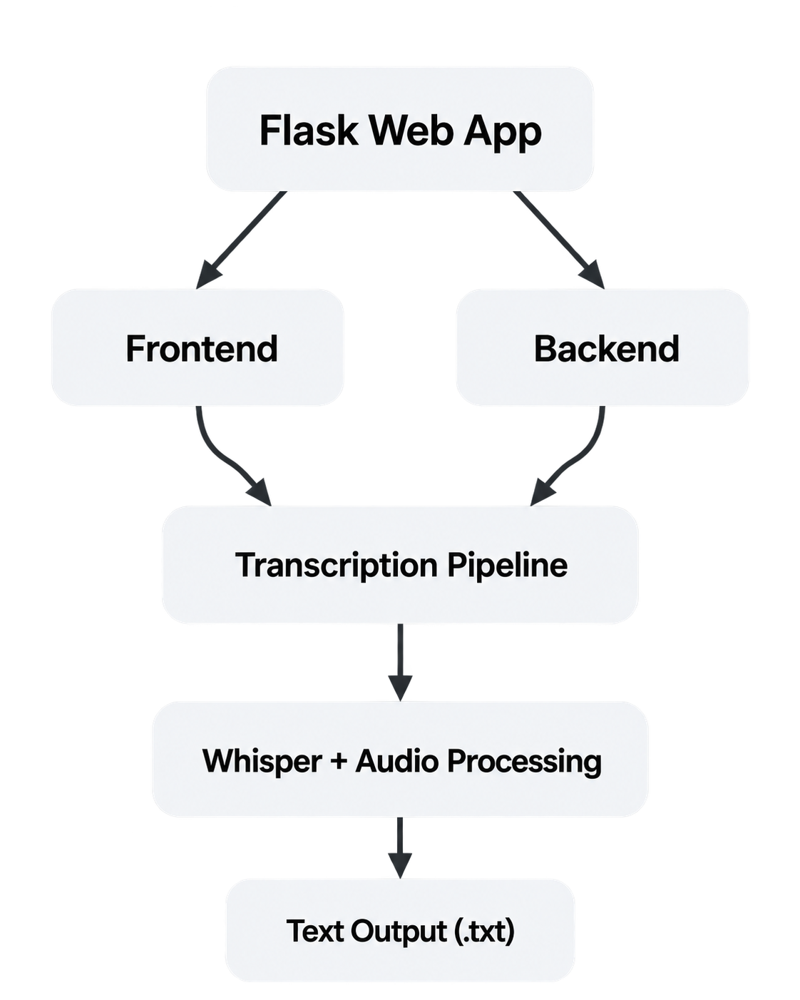

<div align="center">

<h1>Audio to Text Converter System</h1>

<p>A Flask-based web application that converts uploaded audio files into text using OpenAI Whisper.</p>

<p>A personal project developed to practice <b>Flask, Python, and fundamental web development</b> while exploring speech recognition and audio processing.</p>

<p>
  
  
  
  
  
  
  
</p>

<p><b>Status:</b> Local development project</p>

</div>

---

## Overview

Audio to Text Converter System is a personal learning project built to strengthen my understanding of Flask and full-stack web development. It connects a browser-based interface to a Python backend and uses a local speech recognition model to transcribe uploaded audio.

The project helped me explore request handling, file uploads, client-server communication, audio preprocessing, and presenting generated output in a web interface.

The current implementation processes **uploaded audio files**, not live microphone input or real-time computer audio.

## Features

- **Audio file upload:** Choose an audio file through the web interface.
- **Local transcription:** Process audio with OpenAI Whisper's `base` speech recognition model.
- **Audio preprocessing:** Convert uploaded audio to WAV using FFmpeg and split audio into non-silent regions using Librosa.
- **Transcript cleanup:** Apply basic text formatting and remove selected filler words and utterances.
- **Text preview:** Display the generated transcript in a scrollable text area.
- **Download as TXT:** Save a transcript locally as a `.txt` file through the browser.
- **Copy to clipboard:** Copy the generated transcript with one click.
- **Loading indicator:** Display a transcription progress overlay while the server processes the file.

> **Note:** This project does not currently perform speaker diarization. Its paragraph breaks follow processed audio segments, not verified speaker changes. It also does not guarantee accurate identification of inaudible speech or strict adherence to professional transcription guidelines.

## Tech Stack

| Technology     | Purpose                                                       |
| -------------- | ------------------------------------------------------------- |
| Python         | Backend application logic and audio-processing pipeline       |
| Flask          | Web routes, file uploads, and HTTP responses                  |
| OpenAI Whisper | Local speech-to-text inference with the `base` model          |
| Librosa        | Loading audio and detecting non-silent intervals              |
| SoundFile      | Writing temporary audio chunks                                |
| FFmpeg         | Converting uploaded audio into WAV                            |
| HTML5          | Page structure and file upload form                           |
| CSS3           | Interface styling and loading overlay                         |
| JavaScript     | Asynchronous requests, transcript display, copy, and download |

## System Architecture

The browser presents the upload interface and sends an audio file to Flask. The server converts and processes that file locally, runs transcription, formats the result, and returns plain text to the browser.

<div align="center">
  
</div>

Uploaded audio files and server-generated transcripts are stored in local `uploads/` and `texts/` directories. They are not automatically deleted by the current implementation.

## Project Structure

```text
Audio-to-Text-Converter-System/
├── assets/
│   ├── app-flow.png         # Transcription workflow diagram
│   └── system-archi.png     # System architecture diagram
├── static/
│   ├── main.css             # Interface styling
│   └── main.js              # Upload, copy, and download behavior
├── templates/
│   └── index.html           # Main HTML interface
├── app.py                   # Flask routes and transcription logic
├── README.md                # Project documentation
└── README.txt               # Original project notes
```

The application creates `uploads/` and `texts/` at runtime. These folders are not part of the original source code and should not be committed if they contain audio or transcripts.

## Getting Started

This project runs locally and does not require an external speech-to-text API key.

### Prerequisites

Install the following before running the application:

- [Python](https://www.python.org/downloads/) (Python 3.11 is a reasonable compatibility choice)
- [Git](https://git-scm.com/downloads)
- [FFmpeg](https://ffmpeg.org/download.html), with its executable available on your system `PATH`
- An internet connection for the initial Whisper model download, if the model is not already cached

Run the following command to confirm FFmpeg is available:

```bash
ffmpeg -version
```

### 1. Clone the Repository

```bash
git clone https://github.com/johncarlonas/Audio-to-Text-Converter-System.git
cd Audio-to-Text-Converter-System
```

### 2. Create a Virtual Environment

**Windows (PowerShell):**

```powershell
py -m venv .venv
.\.venv\Scripts\Activate.ps1
```

**macOS / Linux:**

```bash
python3 -m venv .venv
source .venv/bin/activate
```

### 3. Install Python Dependencies

The current repository does not include a `requirements.txt` file. Install the libraries imported by `app.py`:

```bash
python -m pip install --upgrade pip
python -m pip install Flask openai-whisper librosa soundfile
```

Whisper uses PyTorch, which is installed as a dependency where compatible packages are available. Your environment may need a platform-specific PyTorch installation. See the [PyTorch installation guide](https://pytorch.org/get-started/locally/) if dependency installation fails.

### 4. Start the Flask Application

Start Flask on the loopback interface with its development debugger disabled:

```bash
python -m flask --app app run --host 127.0.0.1 --port 5000 --no-debugger --no-reload
```

Open the application in your browser:

```text
http://127.0.0.1:5000
```

The first startup can take longer because the application loads the Whisper `base` model when `app.py` is imported. If that model is not cached, Whisper may download the model files.

> The repository's `python app.py` entry point currently uses `debug=True`. The Flask CLI command above is recommended for local use because it does not enable the interactive debugger. Do not expose this development application to the public internet.

## How to Use

1. Open `http://127.0.0.1:5000` in a browser.
2. Click **Choose File** and select an audio file.
3. Click **Upload** to begin transcription.
4. Wait for the loading overlay to close.
5. Review the text in the transcript area.
6. Enter a file name if you want to download the transcript.
7. Click **Download** to save a `.txt` file, or **Copy** to copy the text.

Processing time depends on the file length and available hardware. A successful result depends on FFmpeg support for the uploaded format and Whisper's recognition accuracy.

## Application Routes

| Method | Route                    | Description                                                                                              |
| ------ | ------------------------ | -------------------------------------------------------------------------------------------------------- |
| `GET`  | `/`                      | Renders the upload and transcription interface.                                                          |
| `POST` | `/transcribe`            | Accepts an uploaded audio file, processes it, saves a server-side `.txt` result, and returns plain text. |
| `GET`  | `/download?filename=...` | Downloads a previously generated text file from the server, if it exists.                                |

The current frontend's **Download** button creates a text file directly in the browser using a Blob. It does not call the `/download` route.

### Example Local Request

After the server starts, you can send an audio file directly to the transcription endpoint:

```bash
curl -X POST http://127.0.0.1:5000/transcribe \
  -F "audio=@sample.mp3" \
  -F "filename=my_transcript"
```

Replace `sample.mp3` with the path to your own audio file.

## Current Limitations

This repository was created as a learning project. It is not production-ready.

- Speech recognition uses a locally loaded Whisper `base` model and may be slow on CPU-only systems.
- Audio is processed after upload, not streamed in real time.
- Speaker identification and diarization are not implemented.
- Transcript formatting uses simple string replacements and may remove words that should remain.
- There is no user account system or authentication.
- Uploaded audio and generated transcripts remain on disk unless manually deleted.
- The app has no automated tests or pinned Python dependency versions in the repository.
- Input file size and media type are not currently enforced by the Flask backend.

For security, use only trusted audio files while running the unmodified prototype locally. The upload handling and server configuration should be hardened before any shared or public deployment.

## What I Learned

Building this project gave me hands-on practice with:

- Structuring a Flask application around routes, templates, and static assets.
- Sending files asynchronously from JavaScript using `fetch` and `FormData`.
- Integrating a Python machine learning library into a web application.
- Handling file conversion and audio preprocessing with FFmpeg and Librosa.
- Returning generated content to the browser and supporting file downloads.
- Understanding practical limitations of speech-to-text systems.

## Future Improvements

Potential improvements include server-side file validation, safe temporary storage and cleanup, more accurate transcript formatting, support for speaker diarization, improved error handling, dependency pinning, and automated tests.

---

<div align="center">

**Audio to Text Converter System**

A personal Flask and web development learning project by [John Carlo E. Nas](https://github.com/johncarlonas).

</div>
